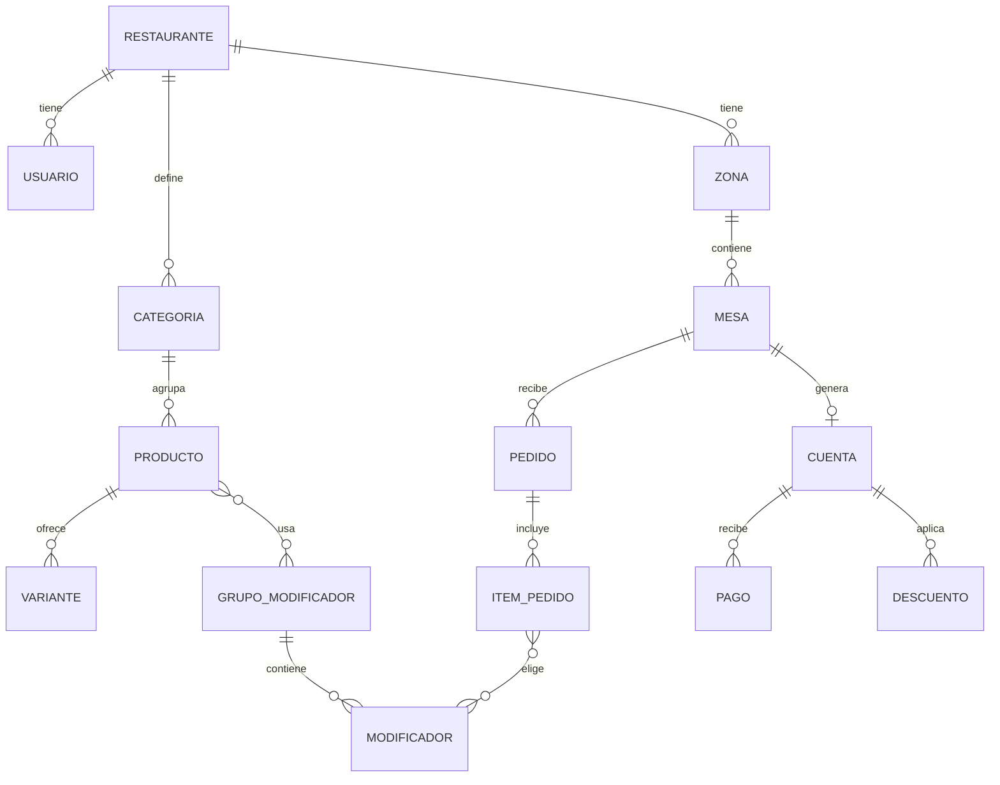

# Comanda — Especificación de requerimientos

API multi-restaurante para gestionar cartas personalizables, pedidos, cuentas y reportes en restaurantes y bares.

- **Stack propuesto:** Node.js · TypeScript · PostgreSQL · Docker
- **Estado:** especificación inicial (MVP)
- **Versión del documento:** 1.0

---

## 1. Visión y alcance

### 1.1 Objetivo

Permitir que un restaurante o bar configure su propia carta, tome pedidos por mesa, los envíe a cocina o barra y cierre la cuenta con valores calculados correctamente (impuestos, propina, descuentos y pagos).

### 1.2 Dentro del MVP

- API REST documentada (OpenAPI).
- Autenticación con JWT y permisos por rol.
- Multi-restaurante con aislamiento total de datos.
- Carta personalizable: categorías, productos, variantes, modificadores, disponibilidad y precios por horario.
- Mesas, zonas y pedidos con estados.
- Cuentas con impuestos, propinas, descuentos, división y pagos.
- Reportes básicos y auditoría.
- Pruebas automatizadas, CI y despliegue con Docker Compose.

### 1.3 Fuera del MVP (fases posteriores)

- Pasarela de pagos real.
- Facturación electrónica.
- Aplicación móvil.
- Impresión de comandas.
- Inventario de insumos y recetas.
- Reservas de mesas.

---

## 2. Roles y permisos

| Rol                | Descripción                     | Permisos principales                                                      |
| ------------------ | ------------------------------- | ------------------------------------------------------------------------- |
| **Superadmin**     | Operador de la plataforma       | Crear y gestionar restaurantes (tenants)                                  |
| **Administrador**  | Dueño o gerente del restaurante | Configurar restaurante, carta, usuarios, impuestos, descuentos y reportes |
| **Mesero**         | Atiende las mesas               | Abrir mesas, crear y modificar pedidos propios, ver carta                 |
| **Cocina / Barra** | Prepara los pedidos             | Ver ítems de su área y actualizar su estado                               |
| **Cajero**         | Cobra                           | Cerrar cuentas, aplicar descuentos autorizados y registrar pagos          |

**Regla general:** cada endpoint valida el rol del usuario y que el recurso pertenezca a su restaurante.

---

## 3. Requerimientos funcionales

### 3.1 Autenticación y usuarios

| ID    | Requerimiento                                                                                        | Prioridad |
| ----- | ---------------------------------------------------------------------------------------------------- | --------- |
| RF-01 | Inicio de sesión con correo y contraseña, con respuesta de _access token_ (corto) y _refresh token_. | Alta      |
| RF-02 | Renovación del _access token_ mediante _refresh token_, con rotación y revocación al cerrar sesión.  | Alta      |
| RF-03 | El administrador crea, edita, desactiva y reactiva usuarios de su restaurante, y asigna roles.       | Alta      |
| RF-04 | Control de acceso por rol en todos los endpoints.                                                    | Alta      |
| RF-05 | Aislamiento por restaurante: ningún usuario accede a datos de otro restaurante.                      | Alta      |
| RF-06 | El superadmin crea restaurantes y su primer administrador.                                           | Alta      |
| RF-07 | Cambio y recuperación de contraseña.                                                                 | Media     |

### 3.2 Carta personalizable

| ID    | Requerimiento                                                                                                                                  | Prioridad |
| ----- | ---------------------------------------------------------------------------------------------------------------------------------------------- | --------- |
| RF-10 | CRUD de **categorías** con orden personalizado y estado activo/inactivo.                                                                       | Alta      |
| RF-11 | CRUD de **productos**: nombre, descripción, precio base, imagen opcional, categoría y **área de preparación** (cocina o barra).                | Alta      |
| RF-12 | **Variantes** por producto (por ejemplo, tamaño o presentación), cada una con su precio.                                                       | Alta      |
| RF-13 | **Grupos de modificadores** (por ejemplo, "punto de cocción", "adiciones") con reglas: obligatorio u opcional, mínimo y máximo de selecciones. | Alta      |
| RF-14 | **Modificadores** con costo adicional opcional (puede ser cero).                                                                               | Alta      |
| RF-15 | Marcar un producto como **agotado** o disponible de forma inmediata.                                                                           | Alta      |
| RF-16 | **Disponibilidad por horario** (por ejemplo, menú de almuerzo solo de 12:00 a 15:00).                                                          | Media     |
| RF-17 | **Precios por periodo** (por ejemplo, precio de _happy hour_ de 17:00 a 19:00 y días específicos).                                             | Media     |
| RF-18 | **Combos o menús** compuestos por varios productos, con precio propio.                                                                         | Media     |
| RF-19 | **Versiones de carta**: borrador y publicada; duplicar una carta existente.                                                                    | Baja      |
| RF-20 | Endpoint público de solo lectura de la carta publicada (para código QR o página web).                                                          | Media     |

### 3.3 Mesas y zonas

| ID    | Requerimiento                                                                       | Prioridad |
| ----- | ----------------------------------------------------------------------------------- | --------- |
| RF-30 | CRUD de **zonas** (terraza, salón, barra) y **mesas** (nombre o número, capacidad). | Alta      |
| RF-31 | Estados de mesa: `libre`, `ocupada`, `por_cobrar`.                                  | Alta      |
| RF-32 | Abrir una mesa indicando número de comensales y mesero responsable.                 | Alta      |
| RF-33 | Mover un pedido a otra mesa y unir cuentas de mesas.                                | Baja      |

### 3.4 Pedidos

| ID    | Requerimiento                                                                                                               | Prioridad |
| ----- | --------------------------------------------------------------------------------------------------------------------------- | --------- |
| RF-40 | Crear un pedido para una mesa con ítems: producto, variante, cantidad, modificadores y notas.                               | Alta      |
| RF-41 | Validar las reglas de la carta al crear un ítem (producto disponible, variante válida, mínimos y máximos de modificadores). | Alta      |
| RF-42 | Guardar en cada ítem el **precio vigente en el momento del pedido** (no depende de cambios posteriores en la carta).        | Alta      |
| RF-43 | Agregar ítems a un pedido ya enviado.                                                                                       | Alta      |
| RF-44 | Cancelar ítems con **motivo obligatorio**, registrando quién y cuándo.                                                      | Alta      |
| RF-45 | Estados de cada ítem: `pendiente` → `en_preparacion` → `listo` → `servido`, además de `cancelado`.                          | Alta      |
| RF-46 | **Enrutamiento automático** de cada ítem a cocina o barra según el área del producto.                                       | Alta      |
| RF-47 | Vista por área con los ítems pendientes, ordenados por antigüedad.                                                          | Alta      |
| RF-48 | Notificación en tiempo real al mesero cuando un ítem pasa a `listo` (WebSocket o Server-Sent Events).                       | Baja      |
| RF-49 | Registro de tiempos (creación, inicio de preparación, listo y servido) para métricas.                                       | Media     |

### 3.5 Cuentas y valores

| ID    | Requerimiento                                                                                                                           | Prioridad |
| ----- | --------------------------------------------------------------------------------------------------------------------------------------- | --------- |
| RF-50 | Cálculo del **subtotal** con variantes, modificadores y cantidades.                                                                     | Alta      |
| RF-51 | **Impuestos configurables por restaurante** (por ejemplo, impuesto al consumo o IVA), con opción de precios con impuesto incluido o no. | Alta      |
| RF-52 | **Propina configurable**: porcentaje sugerido y posibilidad de retirarla.                                                               | Alta      |
| RF-53 | **Descuentos** por ítem o por cuenta, en porcentaje o valor fijo, con motivo obligatorio y permiso por rol.                             | Alta      |
| RF-54 | **División de la cuenta** por comensal o por ítems.                                                                                     | Media     |
| RF-55 | **Pagos** en efectivo, tarjeta o transferencia; permite pagos parciales y mixtos.                                                       | Alta      |
| RF-56 | Cierre de cuenta solo cuando el total pagado cubre el total; la mesa vuelve a `libre`.                                                  | Alta      |
| RF-57 | Anulación de una cuenta cerrada con permiso de administrador y registro de auditoría.                                                   | Media     |

### 3.6 Reportes

| ID    | Requerimiento                                          | Prioridad |
| ----- | ------------------------------------------------------ | --------- |
| RF-60 | Ventas por día y por rango de fechas.                  | Alta      |
| RF-61 | Ventas por categoría, producto y mesero.               | Media     |
| RF-62 | Productos más y menos vendidos.                        | Media     |
| RF-63 | Ticket promedio y ocupación de mesas.                  | Media     |
| RF-64 | Tiempo promedio de preparación por área.               | Baja      |
| RF-65 | Cierre de caja por turno (totales por método de pago). | Media     |
| RF-66 | Exportación de reportes a CSV.                         | Baja      |

### 3.7 Auditoría

| ID    | Requerimiento                                                                                                                               | Prioridad |
| ----- | ------------------------------------------------------------------------------------------------------------------------------------------- | --------- |
| RF-70 | Registrar acciones sensibles: cancelaciones, descuentos, cambios de precio y anulaciones, con usuario, fecha, valor anterior y valor nuevo. | Alta      |
| RF-71 | Consulta del registro de auditoría por parte del administrador, con filtros.                                                                | Media     |

---

## 4. Reglas de negocio

1. Todo valor monetario se guarda como **entero en la unidad mínima** (por ejemplo, pesos o centavos), nunca como número decimal flotante.
2. El total de una cuenta se calcula en este orden: subtotal de ítems → descuentos → impuestos → propina. El orden se documenta y se verifica con pruebas.
3. Un descuento no puede dejar el total en negativo.
4. Un ítem `servido` no se puede cancelar sin permiso de administrador.
5. Un producto agotado no puede agregarse a un pedido nuevo, pero los pedidos existentes no se modifican.
6. El precio de un ítem queda fijo en el momento del pedido, aunque la carta cambie después.
7. Una mesa solo puede tener una cuenta abierta a la vez.
8. Una cuenta no se cierra con pagos insuficientes.
9. Los descuentos superiores a un porcentaje configurable requieren aprobación del administrador.
10. Nada se borra físicamente si ya tiene movimientos: se desactiva (_soft delete_).

---

## 5. Requerimientos no funcionales

### 5.1 Seguridad

- Contraseñas con hash (argon2 o bcrypt).
- Validación y sanitización de todas las entradas (por ejemplo, con Zod).
- Límite de intentos de inicio de sesión (_rate limiting_).
- CORS configurado por entorno.
- Secretos y credenciales solo en variables de entorno.
- Consultas parametrizadas (sin concatenar SQL).
- Cabeceras de seguridad HTTP (por ejemplo, con Helmet).
- Pruebas que verifiquen el aislamiento entre restaurantes.

### 5.2 Calidad

- TypeScript en modo estricto.
- Linter y formateador (ESLint y Prettier).
- Cobertura mínima del **70 %** en la lógica de negocio, y cobertura prioritaria en el cálculo de cuentas.
- Convención de commits descriptivos y ramas con Pull Requests.

### 5.3 Rendimiento

- Respuesta por debajo de 300 ms en operaciones comunes en condiciones normales.
- Índices en las consultas frecuentes (por restaurante, mesa, estado y fecha).
- Paginación en todos los listados.

### 5.4 Despliegue y operación

- `docker compose up` levanta API y base de datos con un solo comando.
- Migraciones de base de datos versionadas y automáticas.
- Variables de entorno documentadas (`.env.example`).
- Endpoint de salud (`/health`) y registros (_logs_) estructurados.
- Datos de ejemplo (_seed_) con un restaurante demo.

### 5.5 Documentación

- Especificación OpenAPI (Swagger UI).
- README con instalación, arquitectura y decisiones de diseño.
- Diagrama de arquitectura y del modelo de datos.

### 5.6 Integración continua

- GitHub Actions: instalación, lint, pruebas y compilación en cada Pull Request.

---

## 6. Modelo de datos

### 6.1 Entidades principales

`Restaurante`, `Usuario`, `Zona`, `Mesa`, `Categoria`, `Producto`, `Variante`, `GrupoModificador`, `Modificador`, `ReglaPrecio`, `Combo`, `Pedido`, `ItemPedido`, `ItemModificador`, `Cuenta`, `Descuento`, `Pago`, `RegistroAuditoria`.

### 6.2 Convenciones

- Todas las tablas de negocio incluyen `restaurante_id`.
- Identificadores UUID, y campos `creado_en` y `actualizado_en`.
- Dinero como entero; estados como enumeraciones.

### 6.3 Diagrama (referencia)



---

## 7. Endpoints principales (referencia)

```
# Autenticación
POST   /auth/login
POST   /auth/refresh
POST   /auth/logout

# Usuarios y restaurantes
GET/POST/PATCH   /usuarios
POST             /restaurantes            (superadmin)

# Carta
GET/POST/PATCH   /categorias
GET/POST/PATCH   /productos
GET/POST/PATCH   /productos/:id/variantes
GET/POST/PATCH   /grupos-modificadores
PATCH            /productos/:id/disponibilidad
GET              /publico/:restauranteSlug/carta

# Mesas
GET/POST/PATCH   /zonas
GET/POST/PATCH   /mesas
POST             /mesas/:id/abrir

# Pedidos
POST             /pedidos
POST             /pedidos/:id/items
PATCH            /pedidos/:id/items/:itemId/estado
POST             /pedidos/:id/items/:itemId/cancelar
GET              /areas/:area/items-pendientes

# Cuentas
GET              /cuentas/:id
POST             /cuentas/:id/descuentos
POST             /cuentas/:id/pagos
POST             /cuentas/:id/cerrar

# Reportes y auditoría
GET              /reportes/ventas
GET              /reportes/productos
GET              /reportes/caja
GET              /auditoria
```

---

## 8. Plan por fases

| Fase                        | Contenido                                                                              | Resultado esperado                         |
| --------------------------- | -------------------------------------------------------------------------------------- | ------------------------------------------ |
| **1. Base**                 | Proyecto, Docker, base de datos, migraciones, autenticación, roles y multi-restaurante | Login funcionando y aislamiento verificado |
| **2. Carta**                | Categorías, productos, variantes, modificadores, disponibilidad, precios por horario   | Carta configurable y carta pública         |
| **3. Pedidos**              | Mesas, pedidos, estados, enrutamiento a cocina y barra                                 | Flujo de pedido de punta a punta           |
| **4. Cuentas**              | Cálculo de valores, impuestos, propina, descuentos, división y pagos                   | Cierre de cuenta con pruebas de cálculo    |
| **5. Reportes y auditoría** | Ventas, productos, caja y registro de acciones sensibles                               | Reportes y trazabilidad                    |
| **6. Pulido**               | Documentación, CI, cobertura, tiempo real (opcional) y datos de ejemplo                | Repositorio listo para mostrar             |

---

## 9. Criterios de terminado (MVP)

- [ ] Todo se levanta con `docker compose up`.
- [ ] Un flujo completo funciona de punta a punta: crear carta, abrir mesa, tomar pedido, preparar, cobrar y ver el reporte.
- [ ] Las pruebas pasan en CI y cubren los cálculos de cuenta (impuestos, descuentos, propinas, división y pagos mixtos).
- [ ] Una prueba verifica que un restaurante no puede acceder a datos de otro.
- [ ] La documentación OpenAPI está publicada y es consultable.
- [ ] El README explica instalación, arquitectura y decisiones de diseño.
- [ ] Hay datos de ejemplo para probar sin configurar nada.

---

## 10. Decisiones pendientes

| Tema        | Opciones                                    | Notas                                                                                                      |
| ----------- | ------------------------------------------- | ---------------------------------------------------------------------------------------------------------- |
| Framework   | Express o NestJS                            | NestJS tiene estructura similar a Laravel y aparece en varias ofertas; Express es más simple para empezar. |
| ORM         | Prisma o Drizzle                            | Drizzle aparece en algunas ofertas; Prisma tiene más documentación.                                        |
| Pruebas     | Jest o Vitest                               | Ambas sirven; Vitest es más rápida de configurar con TypeScript.                                           |
| Tiempo real | WebSocket o Server-Sent Events              | Opcional en el MVP; SSE es más sencillo para notificaciones en una sola dirección.                         |
| Frontend    | Solo API, o React mínimo                    | Un frontend pequeño (carta pública y vista de cocina) mejora la presentación del repositorio.              |
| Impuestos   | Reglas simples o configurables por producto | Verificar la normativa vigente del país antes de fijar los porcentajes por defecto.                        |

---

## 11. Riesgos

- **Cálculo de valores:** es la parte más delicada; conviene escribir las pruebas antes que el código.
- **Alcance:** la carta con variantes, modificadores y horarios crece rápido; terminar primero una versión simple y ampliar después.
- **Aislamiento entre restaurantes:** un error aquí es crítico; centralizar el filtro por `restaurante_id` y probarlo.
